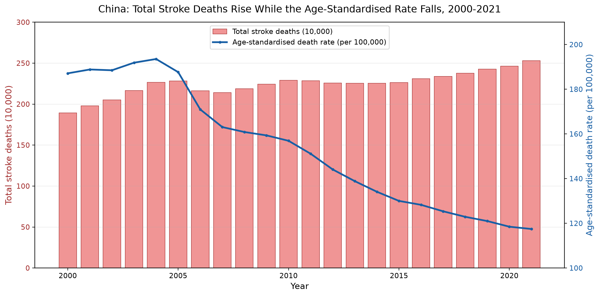

# Li Tianhao — Data Science Portfolio

MSc student in Data Science (Precision Medicine) at the University of Macau. Background in
bioengineering and three years in manufacturing process engineering, now moving into medical
image analysis and applied data science.

This site collects data analysis projects with their code, data sources, and findings, so
that each claim can be traced back to a reproducible notebook.

## Technical skills

- **Languages:** Python (pandas, NumPy, matplotlib), SQL (basic), Java and C (coursework)
- **Analysis:** exploratory data analysis, data cleaning and validation, derived-indicator
  construction, rate standardisation
- **Visualisation:** matplotlib, chart design for a stated audience, critical reading of
  misleading charts
- **Environment:** Jupyter, Git and GitHub, virtual environments, reproducible project layout
- **In progress:** medical image processing, machine learning for imaging

## Project showcase

### The Chinese Stroke Paradox: More Deaths Despite Lower Risk

**Research question.** China's age-standardised stroke death rate fell by 37.2% between 2000
and 2021, yet the total number of stroke deaths rose by 33.6% over the same period. Can this
apparent contradiction be resolved using only public country-level data, and what
demographic mechanism explains it?

**What the chart shows.** The bars are total stroke deaths; the line is the age-standardised
death rate. The two move in opposite directions, and both are correct — the rate measures
individual risk under a fixed age structure, while the count measures burden across the real
population. The bridge between them is population ageing: China's 65+ population more than
doubled (+111.4%) while the total population grew only 12.4%. Deaths grew by 33.6%, which is
above total population growth but below growth of the 65+ group — the evidence points to
ageing pushing deaths up while genuine age-specific risk pushed them down. A second chart in
the repository shows every younger age band shrinking at the same time.

**Status.** Completed. The main open limitation is that the ageing explanation is an indirect
comparison rather than a formal demographic decomposition, because age-specific death counts
are not included in the public files used here.

**Repository.** [Macau-litianhao/data-science-project](https://github.com/Macau-litianhao/data-science-project)
— notebook, four public CSV files under CC BY 4.0, both figures, and full run instructions.

## Coursework

CISC7204 *Data Analysis and Visualisation* (2026): pandas data wrangling, exploratory
analysis, matplotlib visual design, and critique of misleading charts. CISC7201
*Programming for Data Science* (2026).

## Contact

- GitHub: [Macau-litianhao](https://github.com/Macau-litianhao)
- Email: mc66331@um.edu.mo
